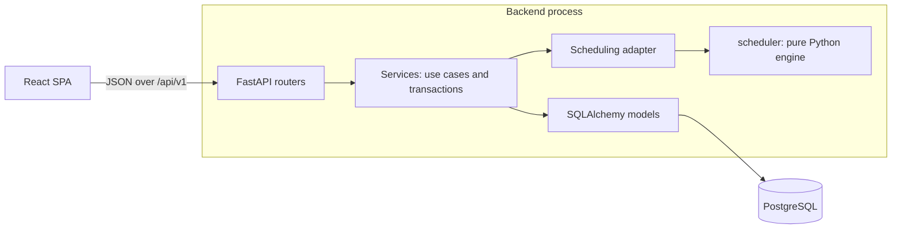

# CoursePilot — Architecture

## 1. System overview



The system is a **modular monolith**: one deployable backend with strict internal boundaries.
Microservices would add network failure modes and deployment work without any benefit at this
size. The boundary that matters, between the scheduling engine and everything else, is enforced
inside one codebase.

## 2. Backend layers

| Layer | Location | Responsibility | Must not |
|-------|----------|----------------|----------|
| Routers | `app/api` | HTTP: parse, authenticate, call a service, shape the response | Contain business rules or queries |
| Schemas | `app/schemas` | Pydantic request and response contracts | Touch the database |
| Services | `app/services` | Use cases; own the transaction boundary | Know about HTTP |
| Models | `app/models` | Tables and database constraints | Contain workflows |
| Engine | `scheduler/` | Pure scheduling logic on plain dataclasses | Import FastAPI, SQLAlchemy or `app` |

**Why the engine is a separate top-level package.** It takes plain data in and returns plain data
out, with the current time passed as an argument. Tests therefore need no database, are fully
reproducible, and can cover DST transitions and thousands of generated scenarios in seconds. A
test in `tests/unit/test_architecture.py` parses the engine's imports and fails if the boundary
is crossed, so the rule cannot erode unnoticed.

**Why there is no repository layer.** SQLAlchemy's `Session` already is a repository and unit of
work. Wrapping it would add a pass-through file per entity. Services query directly, and always
filter by `user_id`.

## 3. Key decisions

Each decision lists the alternative rejected, which is the part worth discussing in an interview.

### 3.1 Synchronous SQLAlchemy over async
FastAPI runs plain `def` endpoints in a thread pool. This app makes short database calls and no
slow outbound calls, so async would bring little throughput and real cost: lazy-loading pitfalls
and harder debugging. The engine is CPU-bound and would block an event loop anyway.

### 3.2 Database constraints as the final guarantee
Application checks can race: two requests can both see a slot as free. PostgreSQL closes that gap:

- An **exclusion constraint** on `study_sessions` makes overlapping active sessions impossible.
- **Composite foreign keys** make it impossible for a task to reference another user's course.
- **CHECK constraints** reject impossible values such as negative remaining effort.

Service-level checks still run, because they give good error messages. The database guarantees
correctness; the service explains failures.

### 3.3 Proposals are stored, not computed on demand
A preview is saved as a `schedule_proposal` with its list of changes. "Apply" then executes exactly
what the user saw, rather than recomputing something that might differ. Proposals live in their
own tables, so previews never collide with the real schedule under the exclusion constraint.

A per-user `schedule_version` is captured in each proposal. Any change to the schedule or to what
a plan depends on (tasks, availability, preferences, time zone) bumps it. If it moved since the
preview, applying returns `409` and asks for a new preview. This is optimistic concurrency.

### 3.4 Authentication: short-lived JWT plus rotating refresh cookie
- **Access token**: 15-minute JWT held in JavaScript memory only, never `localStorage`, so an XSS
  bug cannot steal a long-lived credential from storage.
- **Refresh token**: random opaque value in an `HttpOnly`, `SameSite=Strict` cookie scoped to
  `/api/v1/auth`. Only its SHA-256 hash is stored.
- **Rotation with reuse detection**: each refresh issues a new token. Presenting an already-rotated
  token revokes that whole login family, since it suggests theft. A 10-second grace window keeps
  two browser tabs refreshing at once from logging the user out.

Alternative considered: server-side sessions in a cookie only. That is simpler and fully valid.
The JWT design was chosen as the common pattern for APIs used by single-page apps, and because its
trade-offs are worth understanding. Its usual benefit, skipping a database lookup, is deliberately
not taken here: each request still loads the user, so a deleted account is rejected immediately.
The cost is a more involved refresh flow.

Passwords are hashed with **Argon2id** via `argon2-cffi`. `passlib` is avoided as it is unmaintained.

### 3.5 No task queue
Celery and Redis would be added infrastructure for very little. Time-based effects (missed sessions,
deadline notifications) run as an **idempotent reconcile step** when a user loads the app. A user
who is away has no one to notify in-app, so nothing is lost.

Notifications follow the same rule: `GET /notifications` works out new ones before answering, and
the app asks when it opens and every five minutes. Each notification's `dedupe_key` names its event
(`overdue:<task>:<deadline>`), so asking again inserts nothing and a changed deadline is a new event.

### 3.5a Abuse limits and secrets at rest
Sign-in and registration go through an in-memory sliding window (`app/core/rate_limit.py`): five
failed sign-ins per email and address in 15 minutes, twenty per address, ten registrations an hour.
In memory is right for one process and needs no Redis. Calendar links carry a private token, so they
are stored encrypted with Fernet under `CALENDAR_LINK_KEY` (required in production, different from
the JWT secret), with an HMAC digest to detect duplicates (`app/core/link_cipher.py`).

### 3.6 Strings with CHECK constraints over native PostgreSQL enums
Adding a value to a native enum has awkward migration rules and removing one is very hard. A
`VARCHAR` with a `CHECK` is changed by an ordinary migration and gives the same integrity.

### 3.7 UUIDv7 primary keys
UUIDs prevent enumerating other users' records in URLs. Version 7 is time-ordered, which avoids the
B-tree page splits that random UUIDv4 causes, and is in the Python 3.14 standard library.

## 4. Time handling

Scheduling bugs are mostly time bugs, so there is one rule for each kind of time:

| Kind of time | Example | Stored as |
|--------------|---------|-----------|
| An **instant** | Deadline, session start | `timestamptz` (UTC) |
| A **recurring wall-clock time** | "Mondays 09:00–12:00" | Day of week + minutes since midnight |
| A user's zone | `America/Toronto` | IANA name, validated against `zoneinfo` |

"Mondays at 09:00" is deliberately not stored as UTC, because its UTC value changes when DST does.
It is expanded to real instants one local date at a time, in the user's zone. Minutes-since-midnight
(0–1440) is used instead of `TIME` because Python's `time` cannot represent 24:00, which is needed
for a window that runs to the end of the day. See `SCHEDULING_ENGINE.md` for gaps and repeated hours.

## 5. Error handling and logging

Every error uses one shape, including validation failures, unknown routes and unhandled exceptions:

```json
{ "error": { "code": "email_taken", "message": "…", "details": null, "request_id": "…" } }
```

Services raise typed `AppError` subclasses and know nothing about HTTP responses beyond a status
code on the error class. Unhandled exceptions are logged with a stack trace and return a generic
message, so internals never leak.

Logs are JSON lines from the standard library `logging` module with a small formatter. Each request
gets an ID, returned as `X-Request-ID` and attached to all its log lines. Passwords and tokens are
never logged, and query strings are excluded from access logs.

## 6. Repository structure

```text
CoursePilot/
├── backend/
│   ├── migrations/              # Alembic migrations
│   ├── app/
│   │   ├── api/                 # Routers and dependencies
│   │   ├── core/                # Config, security, errors, logging, middleware
│   │   ├── db/                  # Engine, session, declarative base
│   │   ├── models/              # SQLAlchemy models
│   │   ├── schemas/             # Pydantic contracts
│   │   └── services/            # Use cases
│   ├── scheduler/               # Pure scheduling engine
│   └── tests/{unit,integration}/
├── frontend/src/
│   ├── components/{layout,ui}/  # Shell and design-system primitives
│   ├── features/<domain>/       # Pages, hooks and API calls per domain
│   ├── lib/                     # API client, utilities
│   └── test/
├── docs/
├── docker-compose.yml
└── .github/workflows/ci.yml
```

## 7. API structure

All routes are under `/api/v1`. Interactive docs are served at `/docs`.

| Area | Endpoints | Milestone |
|------|-----------|-----------|
| Auth | `POST /auth/{register,login,refresh,logout}` | M1 |
| Profile | `GET, PATCH /users/me` | M1 |
| Health | `GET /health`, `GET /health/ready` (unversioned) | M1 |
| Courses | `GET, POST /courses`, `GET, PATCH, DELETE /courses/{id}` (progress is included) | M2 |
| Tasks | `GET, POST /tasks` (filters and paging), `GET, PATCH, DELETE /tasks/{id}`, `POST /tasks/{id}/progress` | M2 |
| Availability | `GET, PUT /availability/windows` (replaces the week), CRUD `/availability/recurring-blocks`, `/availability/one-off-blocks` | M2 |
| Preferences | `GET, PUT /preferences`, `PUT /preferences/daily-goal` (a personal target; never changes the schedule) | M2, M8 |
| Schedule | `POST /schedule/preview` (repair or regenerate), `GET /schedule/status`, `GET /schedule/proposals/{current,{id}}`, `POST …/{id}/apply`, `POST …/{id}/reject` | M3–M4 |
| Sessions | `GET, POST /sessions`, `PATCH, DELETE /sessions/{id}`, `POST …/{id}/{lock,unlock}`, `POST /sessions/check-placement` | M3–M4 |
| Session timer | `GET /sessions/active`, `POST /sessions/{id}/{start,pause,resume,finish,discard}`, `POST /sessions/quick-start` (time any task now, without a planned session) | M5, M8 |
| Dashboard, analytics | `GET /dashboard` (with today's progress, streak and recent sessions), `GET /analytics?weeks=`, `GET /month?month=YYYY-MM` | M5, M8 |
| Busy times | `GET /busy-times?start=&end=` (weekly, one-off and imported, combined) | M6 |
| Connected calendars | `GET, POST /calendar-feeds`, `PATCH, DELETE /calendar-feeds/{id}`, `POST …/{id}/sync`, `POST /calendar-feeds/sync-stale` | M6 |
| Deadline suggestions | `GET /deadline-suggestions`, `POST …/{id}/accept`, `POST …/{id}/dismiss` | M6 |
| Notifications | `GET /notifications`, `POST /notifications/{id}/read`, `POST /notifications/read-all` | M8 |

Requests for another user's resource return `404`, not `403`, so that existence is not revealed.

## 8. Frontend architecture

- **Server state** lives in TanStack Query, which handles caching, loading and invalidation. Redux
  would mostly duplicate it.
- **Auth state** lives in one small React context. The access token stays inside the API client module.
- **Code is organized by feature**, so a domain's pages, hooks and API calls sit together.
- **`lib/api.ts`** is the only code that calls `fetch`. It attaches the token and, on `401`, performs
  one shared refresh, so simultaneous failing requests do not each try to rotate the token.
- **Same origin in every environment.** A Vite proxy in development, and a reverse proxy in
  production. This allows the `SameSite=Strict` cookie and avoids CORS.
- **Dates in forms use the profile's time zone**, never the browser's, through `lib/datetime.ts`.
  Luxon does this work because `datetime-local` inputs have no zone and the platform has no widely
  supported way to convert one in a named zone. FullCalendar's named-zone support needs it in M5 too.
- **Themes (M7).** Every colour is a CSS variable in `src/index.css`; dark is the default and
  `:root[data-theme="light"]` overrides the values. Components never name a colour directly, so a
  theme cannot miss a screen. A small script in `index.html` sets the theme before the first paint;
  the choice lives in `localStorage` because it is a display preference, not account data. The
  inline script will need a hash in the Content Security Policy planned for M8.
- **Libraries added when needed:** FullCalendar 6.1 (MIT core with drag, resize and named-zone
  support) and Recharts 3, both in M5. Each loads only on the page that uses it. FullCalendar 7 was
  skipped because it replaces the Luxon plugin with a Temporal polyfill, a second date system.
- **Connected calendars (M6).** `icalendar` (BSD) reads the file and `recurring-ical-events` (LGPL)
  expands repeating events, including exceptions and moved occurrences. LGPL is fine for a library we
  import unchanged. Imported events are stored as one-off blocks tagged with their feed, so the
  scheduling engine needed no change: to it, a class from eClass and a shift typed by hand are the
  same thing.
- **Calendar time zones (the M5 spike).** Sessions go into FullCalendar as UTC instants and are drawn
  in the profile's zone through the Luxon plugin, which is correct. The way back is not: at clock
  changes the plugin picks the *second* occurrence of a repeated hour, and places a time that does not
  exist an hour *before* the gap. Both contradict our rule. So `calendarTimes.ts` reads only the
  wall-clock time the student dropped on and converts it with `lib/datetime.ts`. A move keeps the
  session's real length rather than converting both ends, which could stretch it by an hour. A test
  runs the real FullCalendar conversion, so a library upgrade that changes this will fail.

## 9. Testing strategy

| Level | Tools | Scope |
|-------|-------|-------|
| Engine unit | Pytest (property-based checks in M3) | Invariants, DST, overload, determinism. No database. |
| Backend unit | Pytest | Security helpers, config, formatters |
| API integration | Pytest, `TestClient`, **real PostgreSQL** | Endpoints, constraints, tenant isolation, error shape |
| Migration | Pytest, `alembic check` | Migrations build the schema; models and migrations agree |
| Frontend | Vitest, Testing Library | Components, routing, API client |
| End to end | Playwright (M8) | Core journeys in a real browser |

The integration tests use real PostgreSQL because exclusion constraints, partial indexes and
`timestamptz` behavior do not exist in SQLite. Each test runs in a rolled-back transaction.

## 10. Technical risks

| Risk | Impact | Mitigation |
|------|--------|------------|
| DST and time zone bugs | Sessions at wrong times | One-rule time model; engine DST test matrix |
| Greedy heuristic produces poor plans | Weak core feature | Feasibility guard; measurable quality metrics; CP-SAT comparison in M9 |
| Reschedule causes excessive churn | User distrust | Repair-first algorithm; stability metric tested |
| Concurrent edits corrupt a schedule | Overlaps, lost updates | Exclusion constraint; row lock; version check |
| Engine too slow in Python | Slow previews | Bounded candidates and horizon; benchmark test in M3 |
| Calendar drag and drop with named time zones | M5 complexity | Spiked in M5; see section 8 |
| Fetching links students paste (server-side request forgery) | Probing private networks or cloud metadata | HTTPS only on port 443; every resolved address must be public; the connection is pinned to the checked address; redirects re-checked; size and time capped. See `app/services/feed_fetch.py` |
| Calendar links contain private tokens | A leaked link exposes the student's calendar | Never returned in full or logged. Stored in plain text for now; encrypting at rest is an M8 item |
| Scope (this is a large product) | Unfinished areas | Requirement IDs tracked per milestone |
