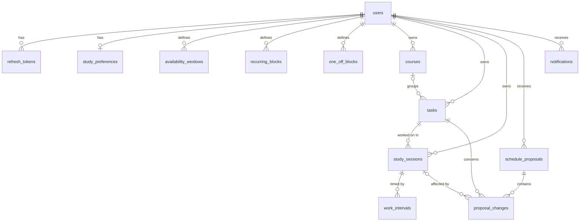

# CoursePilot — Database Design

PostgreSQL 17, managed with Alembic. The full schema is created in Milestone 1 so that its hard
constraints can be tested before features rely on them.

## 1. Entity relationships



## 2. Conventions

- Primary keys are UUIDv7, generated in Python.
- Instants are `timestamptz`. Recurring local times are minutes since midnight. See `ARCHITECTURE.md` §4.
- Durations are integer minutes, since floating-point hours accumulate rounding error.
- Enumerations are `VARCHAR` with a named `CHECK` constraint.
- Constraint names follow a fixed convention, so migrations can refer to them reliably.

## 3. Tables

### Identity

**`users`**: `id`, `email` (unique, must be lowercase), `password_hash`, `display_name`, `timezone`
(IANA name), `schedule_version` (integer, bumped on every schedule change), timestamps.

**`refresh_tokens`**: `id`, `user_id`, `family_id` (all tokens from one login), `token_hash`
(SHA-256, unique), `expires_at`, `revoked_at`, `rotated_at`, `created_at`.

### Academic data

**`courses`**: `id`, `user_id`, `name`, `code`, `description`, `color` (`#rrggbb`), `archived_at`,
timestamps. `UNIQUE (id, user_id)` exists to be the target of composite foreign keys.

**`tasks`**: `id`, `user_id`, `course_id` (nullable), `title`, `description`, `task_type`,
`deadline_at` (nullable), `estimated_minutes` (> 0), `remaining_minutes` (≥ 0), `actual_minutes`
(≥ 0), `priority` (1 low to 4 critical), `status` (`todo`, `in_progress`, `completed`),
`completed_at`, timestamps.

Single-table design: exams and assignments share nearly all columns and all scheduling behavior,
so separate tables would duplicate them. For an exam, `deadline_at` is the exam's start.

### Availability

**`study_preferences`** (one row per user): `preferred_session_minutes`, `min_session_minutes`,
`break_minutes`, `max_daily_minutes`, `deadline_buffer_hours`, `planning_horizon_days`.

**`availability_windows`**: `user_id`, `day_of_week` (0 = Monday), `start_minute`, `end_minute`.

**`recurring_blocks`**: same shape plus `title`. Weekly commitments such as lectures or a job.

**`one_off_blocks`**: `user_id`, `title`, `start_at`, `end_at`. A dentist appointment or trip.

Recurring and one-off blocks are separate tables because one is a wall-clock pattern and the
other a pair of instants. A single table would need columns that are null depending on a type flag.

An overnight window is entered as two windows, one on each day.

### Schedule

**`study_sessions`**: `id`, `user_id`, `task_id`, `start_at`, `end_at`, `status`, `origin`,
`is_locked`, `user_modified_at`, `explanation` (JSONB), timestamps.

| Status | Meaning | Holds its time slot? |
|--------|---------|----------------------|
| `planned` | Scheduled in the future | Yes |
| `in_progress` | Timer running | Yes |
| `paused` | Timer paused | Yes |
| `completed` | Finished | No |
| `missed` | Time passed and it was not started | No |
| `cancelled` | Removed by a schedule change or the user | No |

The engine classifies sessions from these columns:

| Class | Condition | Engine behavior |
|-------|-----------|-----------------|
| **Locked** | `is_locked` | Never moved or removed |
| **Sticky** | `origin = manual` or `user_modified_at` is set | Kept unless impossible; any change is flagged |
| **Flexible** | Otherwise | Kept if still valid; may be moved during repair |

**`work_intervals`**: `id`, `user_id`, `session_id`, `started_at`, `ended_at` (null while running).
Pause and resume close one interval and open another, so actual time is a sum and survives a page
reload or a closed browser.

**`schedule_proposals`**: `id`, `user_id`, `trigger`, `status` (`pending`, `applied`, `rejected`,
`superseded`), `base_schedule_version`, `summary` (JSONB: at-risk tasks, stability), `decided_at`, `created_at`.

**`proposal_changes`**: `id`, `proposal_id`, `action` (`create`, `move`, `resize`, `remove`),
`session_id` (nullable), `task_id`, `before_start_at`, `before_end_at`, `after_start_at`, `after_end_at`,
`reason` (JSONB). Accessed only through its proposal, so it inherits the owner from there.

### Notifications

**`notifications`**: `id`, `user_id`, `kind`, `title`, `body`, `dedupe_key`, `task_id` (nullable),
`read_at`, `created_at`.

## 4. Integrity rules worth noting

### No overlapping sessions
```sql
ALTER TABLE study_sessions ADD CONSTRAINT excl_study_sessions_no_overlap
  EXCLUDE USING gist (user_id WITH =, tstzrange(start_at, end_at) WITH &&)
  WHERE (status IN ('planned', 'in_progress', 'paused'))
  DEFERRABLE INITIALLY IMMEDIATE;
```

- `btree_gist` is required so a GiST index can compare `user_id` with `=`.
- `tstzrange` is half-open, `[start, end)`, so back-to-back sessions do not conflict.
- `DEFERRABLE` matters. When a proposal swaps sessions A and B, the intermediate state overlaps.
  Applying a proposal uses `SET CONSTRAINTS … DEFERRED`, so the check happens at commit.

### Tenant isolation in the schema
`tasks (course_id, user_id)` references `courses (id, user_id)`, and `study_sessions (task_id, user_id)`
references `tasks (id, user_id)`. Even a bug in service code cannot link one user's task to another's
course. A null `course_id` skips the check, as SQL `MATCH SIMPLE` specifies.

### Partial unique indexes
| Index | Guarantees |
|-------|------------|
| `work_intervals (user_id) WHERE ended_at IS NULL` | At most one running timer per user |
| `schedule_proposals (user_id) WHERE status = 'pending'` | At most one open preview per user |

### Notification deduplication
`UNIQUE (user_id, dedupe_key)` with `INSERT … ON CONFLICT DO NOTHING`. The key encodes the event, for
example `deadline:<task>:<deadline>:24h`. Repeat reconciles are harmless, and a *changed* deadline
produces a new key and so a new notification.

## 5. Deletion behavior

Deleting a user cascades to everything they own. Deleting a course cascades to its tasks, and
deleting a task cascades to its sessions. The UI must warn about this. Archiving a course
(`archived_at`) is the non-destructive alternative that keeps analytics history.

## 6. Indexes

| Index | Serves |
|-------|--------|
| `tasks (user_id, status, deadline_at)` | Upcoming and open tasks |
| `tasks (course_id)` | Tasks of a course, cascades |
| `study_sessions (user_id, start_at)` | Calendar range queries, including history |
| `study_sessions (task_id)` | Sessions of a task, cascades |
| GiST exclusion index on `study_sessions` | Overlap lookups among active sessions |
| `refresh_tokens (user_id)`, `(family_id)` | Revocation |
| `courses (user_id)` | Course list |
| `recurring_blocks (user_id)`, `one_off_blocks (user_id, start_at)` | Building the timeline |
| GiST exclusion index on `availability_windows` | Overlap checks; also serves per-user lookups |
| `notifications (user_id, created_at)` | Notification feed |
| `proposal_changes (proposal_id)`, `(session_id)`, `(task_id)` | Proposal detail, cascades |
| `work_intervals (session_id)` | Timer totals |
